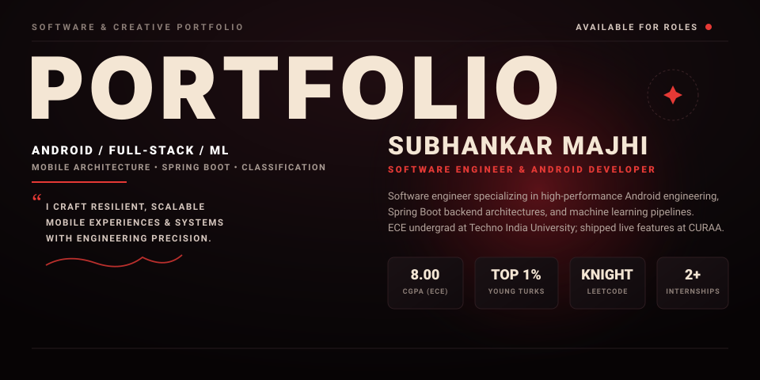

  <!-- Editorial Top Poster SVG -->
  

    

  <!-- Primary Action Strip -->
  
  &nbsp;
  
  &nbsp;
  

 

<!-- ================= WHAT I DO ================= -->
### ✦ WHAT I DO

<table>
  <tr>
    <td width="20%" valign="top">
      <h4>📱 ANDROID DEV</h4>
      Developing native applications in Java &amp; Kotlin with clean architecture, lifecycle safety, and smooth UI.
    </td>
    <td width="20%" valign="top">
      <h4>⚙️ BACKEND APIS</h4>
      Designing robust RESTful web services using Spring Boot &amp; Node.js backed by MySQL databases.
    </td>
    <td width="20%" valign="top">
      <h4>🤖 MACHINE LEARNING</h4>
      Constructing data pipelines &amp; training predictive classifiers with Scikit-learn, XGBoost, and Pandas.
    </td>
    <td width="20%" valign="top">
      <h4>🌐 FULL-STACK WEB</h4>
      Crafting responsive, performant web applications using React, Next.js, TypeScript, and modern styling.
    </td>
    <td width="20%" valign="top">
      <h4>🏗️ SYSTEM DESIGN</h4>
      Applying OOP patterns, test-driven methodologies, and modular code structures across the full SDLC.
    </td>
  </tr>
</table>

 

<!-- ================= PROCESS & FEATURED WORK ================= -->
<table>
  <tr>
    <th width="32%" align="left"><h3>✦ MY PROCESS</h3></th>
    <th width="68%" align="left"><h3>✦ FEATURED WORK</h3></th>
  </tr>
  <tr>
    <td valign="top">
       
      <b>01 — ANALYZE</b> 
      Deconstructing core product requirements, edge cases, and data schemas.
        
      <b>02 — ARCHITECT</b> 
      Designing scalable data models, API contracts, and modular software boundaries.
        
      <b>03 — DEVELOP</b> 
      Writing clean, maintainable code in Java, Kotlin, Python, and TypeScript.
        
      <b>04 — TEST &amp; PROFILE</b> 
      Structured unit testing, benchmark profiling, and runtime memory optimization.
        
      <b>05 — SHIP</b> 
      Deploying to live production, setting up CI/CD, and monitoring telemetry.
        
    </td>
    <td valign="top">
      <table>
        <tr>
          <td width="50%" valign="top">
            <h4>💰 <a href="https://github.com/smajhi17/expense-tracker-app">EXPENSE TRACKER APP</a></h4>
            <b>Java • Spring Boot • MySQL • Retrofit</b> 
            Personal finance Android app with real-time balance computation, secure auth, and Spring Boot REST API integration. 
            ↳ <a href="https://github.com/smajhi17/expensetracker-backend">Backend Repository</a>
          </td>
          <td width="50%" valign="top">
            <h4>❤️ <a href="https://github.com/smajhi17/Heart-Disease-Classification">HEART DISEASE CLASSIFIER</a></h4>
            <b>Python • Scikit-learn • XGBoost • Pandas</b> 
            End-to-end ML diagnostic pipeline benchmarked to <b>85% accuracy</b> and <b>0.92 AUC-ROC</b> with Random Forest.
          </td>
        </tr>
        <tr>
          <td width="50%" valign="top">
            <h4>🐾 <a href="https://github.com/smajhi17">CURAA PRODUCTION APP</a></h4>
            <b>Android • Cross-Functional SDLC • Production</b> 
            Shipped mobile features end-to-end for a live consumer application, adhering to strict testing and code review standards.
          </td>
          <td width="50%" valign="top">
            <h4>⚡ <a href="https://github.com/smajhi17/Alphabet_Launcher">ALPHABET LAUNCHER &amp; UTILITIES</a></h4>
            <b>Android • Java • Low-Latency</b> 
            Minimalist index-driven Android launcher along with the high-precision <a href="https://github.com/smajhi17/stopwatch">Stopwatch</a> and <a href="https://github.com/smajhi17/Health_Companion">Health Companion</a>.
          </td>
        </tr>
      </table>
    </td>
  </tr>
</table>

 

<!-- ================= ABOUT ME & TOOLS I USE ================= -->
<table>
  <tr>
    <th width="45%" align="left"><h3>✦ ABOUT ME</h3></th>
    <th width="55%" align="left"><h3>✦ TOOLS &amp; STACK</h3></th>
  </tr>
  <tr>
    <td valign="top">
      <table>
        <tr>
          <td width="90" valign="top">
            
          </td>
          <td valign="top">
            <b>Subhankar Majhi</b> 
            Software engineer &amp; ECE undergraduate at <b>Techno India University, Kolkata</b> (CGPA: 8.00). Passionate about high-reliability mobile systems and data-driven intelligence.
          </td>
        </tr>
      </table>
       
      <ul>
        <li><b>LeetCode Knight</b> (70+ DSA Problems Solved)</li>
        <li><b>Top 1% Nationwide</b> — Naukri Campus Young Turks 2025</li>
        <li><b>Top 15 Finalist</b> — Gen AI Study Jams</li>
        <li><b>Ex-Campus Ambassador</b> — IIT Delhi (Rendezvous)</li>
      </ul>
    </td>
    <td valign="top">
      

        
      

      <blockquote>
        <i>“ Shipped production-ready mobile features end-to-end at CURAA, partnering across the SDLC with peer code reviews and structured automated testing. ”</i>
      </blockquote>
    </td>
  </tr>
</table>

 

<!-- ================= FOOTER / LET'S COLLABORATE ================= -->
<table>
  <tr>
    <th width="35%" align="left"><h3>✦ LET'S COLLABORATE</h3></th>
    <th width="35%" align="center"><h3>✦ SCAN TO CONNECT</h3></th>
    <th width="30%" align="right"><h3>✦ PHILOSOPHY</h3></th>
  </tr>
  <tr>
    <td valign="top">
      Have an opportunity, project, or technical question? Feel free to reach out.
        
      📧 <b>Email:</b> <a href="mailto:subhankarmajhi0017@gmail.com">subhankarmajhi0017@gmail.com</a> 
      📞 <b>Phone:</b> <code>+91 8348551148</code> 
      📍 <b>Location:</b> Kolkata, West Bengal, India 
      📄 <b>Resume:</b> <a href="./Subhankar_Majhi_Resume.pdf">Subhankar_Majhi_Resume.pdf</a>
    </td>
    <td align="center" valign="top">
      <table>
        <tr>
          <td align="center">
             
            <b>LINKEDIN</b>
          </td>
          <td align="center">
             
            <b>RESUME (PDF)</b>
          </td>
        </tr>
      </table>
    </td>
    <td align="right" valign="middle">
      <h3 style="letter-spacing: 2px;">ENGINEERING EXPERIENCES.</h3>
      <h3 style="letter-spacing: 2px;">BUILDING SOLUTIONS.</h3>
      — <b>Subhankar Majhi</b>
    </td>
  </tr>
</table>
