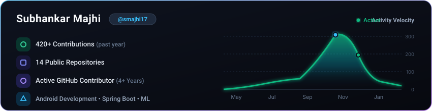
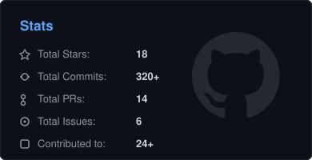
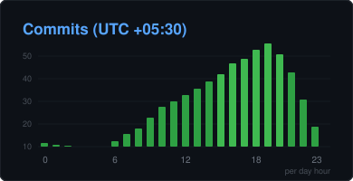
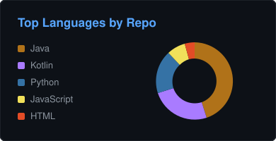
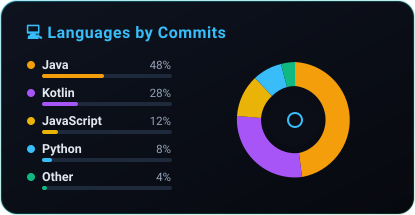
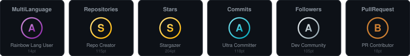
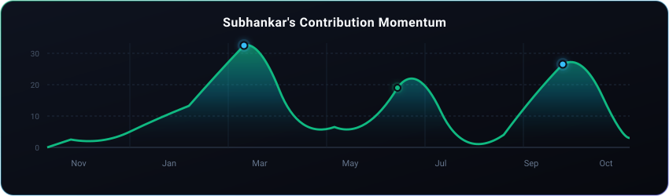

  <h1>Hey there, I'm Subhankar Majhi 👋</h1>

  

    
  

  

    
    &nbsp;
    
    &nbsp;
    
    &nbsp;
    
  

 

- 👨‍💻 **Building high-performance Android & full-stack applications with engineering precision.**
- 💼 **App Development Intern @ CURAA &amp; Software Development Intern @ Cognifyz**
- 🎓 **ECE Undergrad @ Techno India University, Kolkata (2024–2028, CGPA: 8.00)**
- ⚔️ **LeetCode Knight (70+ DSA Solved) &amp; Top 1% in Naukri Campus Young Turks 2025**
- 📖 **Focused on robust software architecture, modular systems &amp; clean design patterns**
- 🛠️ **Experienced across Java, Kotlin, Spring Boot, MySQL, Python, and Machine Learning**
- 🤝 **Open to collaboration, open-source initiatives &amp; high-impact software engineering roles**
- 📄 **Resume:** <a href="https://github.com/smajhi17/smajhi17/blob/main/Subhankar_Majhi_Resume.pdf"><b>Download Subhankar's Resume (PDF)</b></a>

  

  

 

<!-- ================= MODERN 2026 METRICS SUITE ================= -->

  

&nbsp;
  

&nbsp;
  

  

  

